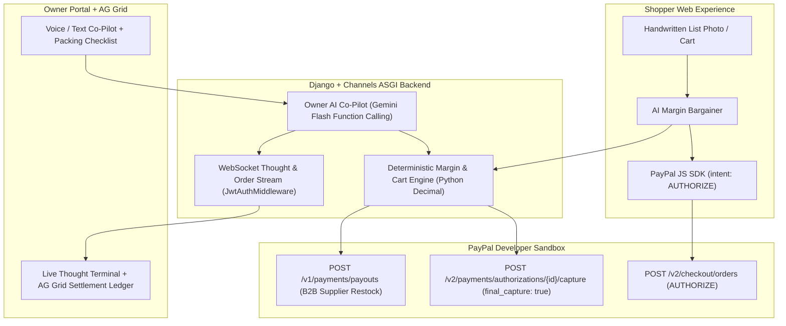

# CartSettle — Autonomous PayPal Settlement, Margin Bargaining & Voice Co-Pilot for Independent Grocers

## Problem Statement & Proposed Solution (PayPal AI Hackathon 2026)

---

## Executive Summary
**CartSettle** is a production-grade, mobile-first web commerce and payment orchestration platform built for independent neighborhood grocers and specialty food retailers.

Independent grocers operate on razor-thin **3%–8% net profit margins**, yet standard fixed-price online checkouts bleed money across three broken payment touchpoints: **unsold expiring inventory**, **packing-table item shortages that trigger costly refund disputes**, and **manual back-office supplier restocks**. **CartSettle** solves all three by turning **PayPal's Developer Platform (`AUTHORIZE` → Dynamic Partial `CAPTURE` → B2B `PAYOUTS`)** into an autonomous, AI-orchestrated financial engine—governed by deterministic Python `Decimal` guardrails and streamed live over JWT-authenticated WebSockets.

---

## 1. The Problem Statement: 3 Payment & Margin Leaks Killing Small Grocers

1. **Pre-Checkout Leak — Rigid Catalog Pricing Causes Perishable Spoilage & Cart Abandonment:**
   - Perishable inventory approaching `expiry_date` goes unsold (100% capital loss), while price-sensitive shoppers abandon rigid full-price carts.
   - Merchants lack a safe, automated way to negotiate dynamic bundle or clearance deals at checkout without risking selling below `cost_price`.
2. **Fulfillment Leak — Packing-Table Shortages Cause Refund Friction & Chargebacks:**
   - Shelf inventory in neighborhood stores changes by the minute. A shopper pays `$42.00` online for 8 items, but at the packing counter 1 item (`$6.50`) is bruised or out of stock.
   - Traditional immediate-capture checkouts force manual partial refunds, delayed funds, customer frustration, and payment disputes.
3. **Back-Office Leak — Occupied Hands & Disconnected Supplier Restocks:**
   - Store owners working the counter cannot click through 10 nested admin screens to adjust expiring prices, audit margins, and pay wholesale distributors when staple items run low.

---

## 2. The Solution: Dual-Agent PayPal Payment & Margin Engine

**CartSettle** pairs **Google Gemini Multimodal & Function-Calling Agents** with **strict deterministic Python financial math** and **three core PayPal Sandbox APIs**:

```
┌────────────────────────────────────────────────────────────────────────┐
│                              CARTSETTLE                                │
├──────────────────────────────────┬─────────────────────────────────────┤
│   DETERMINISTIC AUTHORITY LAYER  │       AI INTELLIGENCE LAYER         │
│  (Python Decimal / Django / DB)  │    (Gemini Flash Multimodal/Tools)  │
├──────────────────────────────────┼─────────────────────────────────────┤
│ • Cost-Price & Margin Floor Math │ • Handwritten List / Voice-to-Cart  │
│ • Exact Cart & Tax Calculation   │ • Live Buyer Margin Bargaining      │
│ • PayPal Auth / Partial Capture  │ • Hands-Free Owner Voice Co-Pilot   │
│ • PayPal B2B Supplier Payouts    │ • Multi-Step Operational Chaining   │
│ • JWT Role Isolation (IsOwner)   │ • Live WebSocket Thought Streaming  │
└──────────────────────────────────┴─────────────────────────────────────┘
```

### Pillar 1: Multimodal List-to-Cart & Margin-Guarded Bargaining (`PayPal Orders v2 — AUTHORIZE`)
* **List/Slip-to-Cart:** Shoppers upload a photo of a handwritten shopping list or enter natural text; Multimodal AI matches active in-stock products into the cart immediately.
* **Live Margin-Guarded Checkout Bargaining:** Shoppers negotiate bundle or near-expiry discounts with the store's AI. Deterministic Python enforces `floor_price = cost_price * (1 + min_margin)` so the store **never loses money**, then mints a **time-locked PayPal Sandbox Order (`intent: "AUTHORIZE"`)**—placing a secure hold while physical items are packed.

### Pillar 2: Packing-Table Auto-Settlement (`PayPal Payments v2 — Dynamic Partial CAPTURE`)
* As the shop owner packs the order (via the interactive Packing Checklist or hands-free Voice Co-Pilot), any damaged or out-of-stock `OrderItem` marked `REJECTED` triggers automatic deterministic recalculation.
* CartSettle calls `POST /v2/payments/authorizations/{authorization_id}/capture` with `"final_capture": true` for **only the packed total**—charging the customer the exact fulfilled amount and **instantly releasing the uncaptured hold back to the buyer** with zero refund fees or disputes.

### Pillar 3: Shop Owner Voice/Text AI Co-Pilot & B2B Restock (`PayPal Payouts v1 + WebSockets + AG Grid`)
* Embedded inside the Owner Admin Portal (`Ctrl + K` / floating Co-Pilot drawer) with a **Split-Screen Live Agent Thought & PayPal Ledger Terminal** streamed via **Django Channels WebSockets**.
* **Authorized Owner Capabilities:**
  1. Hands-free price, stock, expiry clearance, and store-status updates (with 1-click Undo audit trail).
  2. Low-stock wholesale reorder staging: computes distributor cost from `cost_price` and executes a **1-Click Human-Approved PayPal Sandbox Batch Payout (`POST /v1/payments/payouts`)**, replenishing stock upon confirmation.
  3. **AG Grid Enterprise Financial & Inventory Ledger** for real-time auditing of PayPal authorization holds, partial captures, net margins, and stock velocity.

---

## 3. End-to-End Architecture Flow


